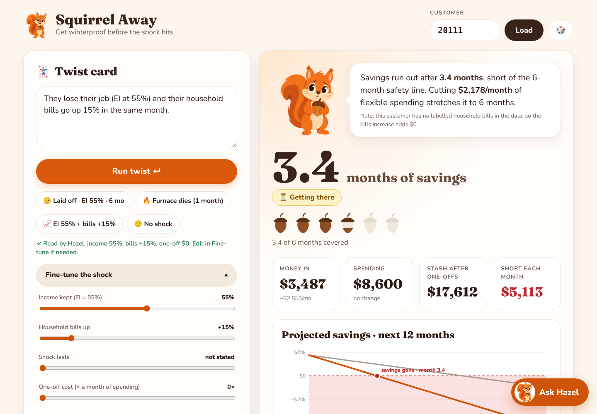

# 🐿️ Squirrel Away
**Get winterproof before the shock hits.**
Team **The Insight Job** · Tangerine track ("Resilience Rewired") · Sheridan Datathon 2026

Squirrel Away is a financial resilience engine with a coach, Hazel. For any bank customer it shows
how long their savings would last after a shock (a layoff, a repair, a rent hike), flags early warning
signs, and builds a plan from the customer's own numbers.



## Our finding
**The warning shows up before the loan.** Every customer whose balance went below $0 in the months
*before* taking a loan later defaulted: **27 of 27 (100%)**, vs **7.5%** of everyone else
(Fisher exact p < 1e-27; still 17 of 17 counting only dips 3+ months before the loan).

- Uneven income = **5.6×** the default rate (22.8% vs 4.1%).
- **1 in 3 customers** (1,578 of 4,500) can't get through a 6-month layoff on EI.
- For 97.5% of at-risk customers, the fix is within reach: the needed cut is smaller than their flexible spending.
- 212 customers without a loan have already dipped below $0, 122 of them in 2025. Reach them before they ask for credit.

Full write-up, data checks and limits: **[FINDINGS.md](FINDINGS.md)** · Charts: [`docs/`](docs)

## What the app does
1. **Know the customer:** income (I), fixed costs (F), spending (S), savings buffer (B), household bills (H),
   loan payment (P), runway, plus 🚩 early-warning flags.
2. **Take a shock:** paste a twist card ("They lose their job (EI at 55%) and bills go up 15%") or use the sliders.
   Runway uses the track's exact formula and is checked against it on all 4,500 accounts.
3. **Make a plan:** a "winter stash" emergency-fund goal and a backup plan built from the customer's own
   flexible spending.
4. **Ask Hazel:** an AI chat (Gemini API) for questions and what-ifs, in any language.
   *Gemini interprets the question, our engine does the math*, so the AI never makes up numbers.
   A rule-based fallback keeps it working without a key or network.

## Why a squirrel? (design choices)
- **The name.** "Squirrel away" means saving money for later, which is exactly the emergency-fund plan.
  The tagline, *get winterproof before the shock hits*, frames every shock (a layoff, a furnace, a rent hike)
  as a "winter" that every customer will face at some point.
- **Hazel, the coach.** A squirrel stashes acorns before winter, which is the behaviour we want to encourage.
  A friendly coach makes hard news ("your savings last 3.4 months") easier to hear than a cold risk score,
  and she explains every result in one plain sentence.
- **Her mood is the result.** Happy = Winterproof, worried = Getting there, alarmed (dropping her acorn) =
  Not ready for winter. The acorn meter shows months covered at a glance.
- **Warm orange palette.** Friendly and trustworthy, and it sits naturally next to a consumer bank's brand
  without copying anyone's logo or name.
- **Accessible by design.** Status always has words and an icon, not colour alone; works by keyboard and on phones;
  respects reduced-motion settings; Ask Hazel answers in any language.

---

## Setup (about 5 minutes)

### 1. Requirements
- **Python 3.10 or newer** (we used 3.12). Check with `py --version` (Windows) or `python3 --version` (Mac/Linux).
  - Windows: `winget install Python.Python.3.12`, then **close and reopen** PowerShell.
- The track's data files (not included in this repo; `transactions.csv` is over GitHub's 100 MB limit).

### 2. Get the code
```bash
git clone https://github.com/t1zaman/datathon.git
cd datathon
```
(Or download the ZIP from GitHub and unzip it.)

### 3. Install packages
Windows (PowerShell):
```powershell
py -m pip install -r requirements.txt
```
Mac / Linux:
```bash
python3 -m pip install -r requirements.txt
```
Yellow "not on PATH" warnings are fine: we always run tools with `py -m` / `python3 -m`.

### 4. Add the data
Copy the Tangerine track CSVs into the `data/` folder. You need at least `monthly_summary.csv` and
`loans.csv`; the analysis also uses `accounts.csv`, `districts.csv`, `clients.csv` and `dispositions.csv`.

Windows example (change the path to where you unzipped the data):
```powershell
Copy-Item C:\path\to\Tangerine\data\*.csv .\data\
dir .\data
```

### 5. (Optional) Turn on Gemini for Ask Hazel
Get a free key at https://aistudio.google.com/apikey. Set it **in the same terminal** you start the app from:

Windows (PowerShell):
```powershell
$env:GEMINI_API_KEY="your_key"
$env:GEMINI_MODEL="gemini-3.5-flash-lite"
```
Mac / Linux:
```bash
export GEMINI_API_KEY="your_key"
export GEMINI_MODEL="gemini-3.5-flash-lite"
```
- `GEMINI_MODEL`: any Flash model your key can use. To list them:
  `py -c "import os; from google import genai; c=genai.Client(api_key=os.environ['GEMINI_API_KEY']); print([m.name for m in c.models.list() if 'flash' in m.name])"`
  Lite models are much faster; slower "thinking" models can take a minute per answer.
- `GEMINI_TIMEOUT` (optional, seconds, default 12): if Gemini is slower, Hazel answers with the built-in rules instead.
- Never commit your key to GitHub.

### 6. Run it
Windows:
```powershell
py -m uvicorn backend.main:app --port 8000
```
Mac / Linux:
```bash
python3 -m uvicorn backend.main:app --port 8000
```
Wait for **"Application startup complete"**, then open **http://127.0.0.1:8000/app**.
Keep the terminal open while using the app (Ctrl+C stops it). API docs: http://127.0.0.1:8000/docs

### 7. Try it
- Type account **20111** → click **"Laid off · EI 55% · 6 mo"** → you should see **3.4 months** and the 🚩 early warning.
- Paste a twist card: *"They lose their job (EI at 55%) and their household bills go up 15% in the same month."*
- Click **Ask Hazel** → "What if they cut cash withdrawals by 20%?"

---

## Reproduce the analysis
```bash
python -m tests.test_consistency          # runway matches the track formula on every account (0 mismatches)
cd analysis
python checks.py ../data                  # data-quality checks
python findings.py ../data                # all findings → analysis/outputs/findings_report.txt
python headline_charts.py ../data         # the 3 headline charts → analysis/outputs/
```
(On Windows use `py` instead of `python`.)

## Troubleshooting
| Problem | Fix |
|---|---|
| `monthly_summary.csv not found` | The CSVs aren't in `data/`. Copy them in (step 4) and check you're in the right folder. |
| `No module named 'fastapi'` | The install didn't finish. Run step 3 again and wait for "Successfully installed". |
| `pip` / `export` not recognized (Windows) | Use `py -m pip …` and `$env:NAME="value"` (PowerShell syntax). |
| Ask Hazel replies say "Hazel rules", not "Gemini" | No key in this terminal, or the model name is retired. Set both variables (step 5) and restart. |
| Ask Hazel is very slow | Use a lite model (`gemini-3.5-flash-lite`); the timeout falls back to rules after 12 s. |
| Twist card read wrong | Fix it with the sliders under "Fine-tune the shock". |

## Project structure
```
backend/              FastAPI engine
  main.py             API + serves the frontend at /app
  metrics/            the six track definitions (I, F, S, B, H, P)
  customer_service.py customer summary + early-warning flags
  shock_simulator.py  shock + runway (track formula) + verdict
  recovery_planner.py winter-stash goal + backup plan
  twist_parser.py     twist card → shock settings (rules first, Gemini for unusual wording)
  chat.py             Ask Hazel (Gemini interprets, engine computes)
frontend/             index.html (HTML/CSS/JS, designed in Lovable) + Hazel images + fonts
analysis/             checks.py, findings.py, headline_charts.py, profiles.py
tests/                test_consistency.py
docs/                 headline charts, app screenshot, findings report
FINDINGS.md           full findings, data checks and limits
demo_app.py           backup Streamlit screen (streamlit run demo_app.py)
```

## API
- `GET  /api/accounts/{id}/summary`: the six numbers, spending breakdown, warnings
- `POST /api/accounts/{id}/simulate`: shock → runway and verdict
- `POST /api/accounts/{id}/recovery`: goal plan + backup plan
- `POST /api/accounts/{id}/chat`: Ask Hazel
- `POST /api/twist/parse` `{"text": "..."}`: twist card → shock settings
- `GET  /api/accounts/random`: random account

## Data and credits
- **PKDD'99 Discovery Challenge Financial dataset** (real anonymized bank data), CTU Prague Relational Dataset Repository:
  https://relational.fel.cvut.cz/dataset/Financial. Dates shifted to 2020–2025 and amounts in CAD by the track organizers.
- **Employment Insurance regular benefits** (Government of Canada): https://www.canada.ca/en/services/benefits/ei/ei-regular-benefit.html
- Built with Python, pandas, FastAPI, scikit-learn, matplotlib, the Google Gemini API, and Lovable (UI design).
- Planning estimates, not financial advice.
